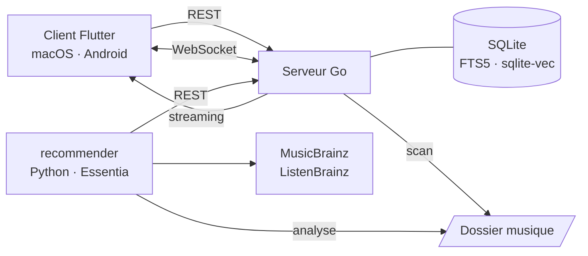

# tty.fm

> **In English** — tty.fm is a self-hosted music player with a terminal-inspired look. A Go + SQLite server indexes your music folder and streams it, a native Flutter client plays it on macOS and Android, and a Python service (Essentia) analyses every track to power similar tracks, an endless radio, daily mixes and new-release tracking via MusicBrainz and ListenBrainz. Playback state syncs live between devices over WebSocket, so one device can remote-control another. It is a personal project, used daily, and its documentation is in French: start with [doc/architecture.md](doc/architecture.md) and [doc/installation.md](doc/installation.md).

Lecteur de musique auto-hébergé, à l'allure de terminal. Un serveur Go + SQLite indexe et diffuse la musique, un client Flutter natif la lit sur macOS et Android, et un service Python analyse chaque morceau pour proposer radio, mix du jour et découvertes.

<!-- Captures : déposer les images dans doc/screenshots/ (voir doc/screenshots/README.md), puis retirer les commentaires.
<p>
  
  
</p>
-->
<!--  -->
<!--  -->
<!--  -->
<!--  -->

## Fonctionnalités

- **Bibliothèque** : scan incrémental du dossier musique, surveillé en continu (fichiers déplacés reconnus, pochettes, paroles synchronisées `.lrc`).
- **Recherche** : plein texte, accents ignorés, filtres par genre, période, format, tempo (`bpm:>120`) et tonalité (`ton:8A`).
- **Lecture** : sans blanc entre les titres, original sur le réseau local, Opus transcodé à distance, contrôles système et écran de verrouillage.
- **Hors ligne** : albums, playlists et favoris téléchargés, tenus à jour, écoutes renvoyées au retour du réseau.
- **Multi-appareils** : état de lecture partagé en direct, télécommande d'un appareil depuis un autre, transfert de la lecture.
- **Playlists** : rangées dans des dossiers, favoris, titres archivés.
- **Analyse audio** : bpm, tonalité (notation Camelot), loudness, énergie, genre et ambiance pour chaque titre, enchaînements compatibles.
- **Recommandations** : titres similaires, radio infinie à partir d'un titre ou d'un artiste, mix du jour tirés de l'historique.
- **Découverte** : nouvelles sorties des artistes de la bibliothèque (MusicBrainz), artistes proches de ceux qu'on aime (ListenBrainz).
- **Stats d'écoute** et message du jour à l'accueil.

## Architecture



Le serveur possède toutes les données ; l'app et le recommender passent par son API. Schéma détaillé et rôle de chaque composant : [doc/architecture.md](doc/architecture.md).

## Stack

| partie | technologies |
|---|---|
| Serveur (`server/`) | Go, SQLite (WAL, FTS5, sqlite-vec), TagLib, ffmpeg, WebSocket |
| Client (`app/`) | Flutter, Riverpod, media_kit (libmpv), audio_service |
| Recommender (`recommender/`) | Python, Essentia et ses modèles TensorFlow |
| Déploiement | Docker Compose, GitHub Actions (CI, releases APK et macOS) |

## État du projet

Projet personnel, utilisé au quotidien sur une seule bibliothèque, avec un seul compte. Tout ce qui est listé plus haut fonctionne : bibliothèque et lecture, synchronisation entre appareils, analyse audio et recommandations. Le travail en cours porte surtout sur l'alignement de l'app avec les maquettes (`design/`). macOS et Android sont pris en charge ; Windows et iOS viendront plus tard, le code étant commun. Le détail est dans la [feuille de route](doc/roadmap.md).

## Documentation

| page | contenu |
|---|---|
| [doc/installation.md](doc/installation.md) | installation avec Docker Compose, configuration, comportement du scan |
| [doc/nas-ugreen.md](doc/nas-ugreen.md) | installation de référence sur un NAS UGREEN, accès distant par Tailscale, déploiement |
| [doc/api.md](doc/api.md) | API REST v1, hub WebSocket, paroles |
| [doc/architecture.md](doc/architecture.md) | composants et flux |
| [app/README.md](app/README.md) | client Flutter : développement, builds, releases, tests |
| [recommender/README.md](recommender/README.md) | analyse audio, MusicBrainz, ListenBrainz |
| [design/HANDOFF.md](design/HANDOFF.md) | écrans, tokens et règles du design |
| [doc/roadmap.md](doc/roadmap.md) | historique, issues ouvertes, écarts avec les maquettes |
| [doc/conventions.md](doc/conventions.md) | branches, commits, pull requests |

## Structure du dépôt

```
server/       API REST, streaming et hub WebSocket (Go, SQLite WAL + FTS5 + sqlite-vec, ffmpeg)
app/          client Flutter (macOS, Android)
recommender/  analyse audio et recherche de sorties et d'artistes proches (Python, Essentia)
design/       maquettes et handoff du design
doc/          documentation
tools/        scripts de déploiement, de mise à jour et de vérification des conventions
```

Le nom affiché est *tty.fm* (`app.Title` dans `server/internal/app/app.go`, `appDisplayName` dans `app/lib/app_info.dart`). L'identifiant technique est `ttyfm` : module Go, binaire, image Docker, préfixe `TTYFM_` des variables, base `ttyfm.db`. Les identifiants de bundle sont `fm.tty.app`.

## Démarrage rapide

```bash
cp .env.example .env        # renseigner MUSIC_DIR, DATA_DIR, ADMIN_PASSWORD
docker compose up -d --build
curl http://localhost:4533/api/v1/health
```

Puis installer l'app (APK et app macOS dans les Releases GitHub, voir [app/README.md](app/README.md)) et se connecter au serveur. Détails, prérequis et accès distant : [doc/installation.md](doc/installation.md).

## Développement

### Serveur

Prérequis : Go ≥ 1.27, un compilateur C (Xcode CLT sur macOS), ffmpeg (`brew install ffmpeg`).

```bash
cd server
make test                                   # tests (ffmpeg requis pour scanner et API)
TTYFM_MUSIC_DIR=~/Music make run            # serveur local sur :4533, données dans ../data
```

Le build tag `sqlite_fts5` est obligatoire : passer par le `Makefile`, ou ajouter `-tags sqlite_fts5` à la main. `tools/demo-library.sh` génère une petite bibliothèque de test dans `data/dev-music`.

### Client et recommender

Voir [app/README.md](app/README.md) et [recommender/README.md](recommender/README.md). Avant de committer dans un nouveau clone, lancer `tools/setup-git.sh` ([doc/conventions.md](doc/conventions.md)).

## Licence

tty.fm est distribué sous licence [GNU AGPL-3.0](LICENSE) (version 3 ou, au choix, toute version ultérieure). Cette licence est compatible avec [Essentia](https://essentia.upf.edu), elle-même sous AGPL-3.0, que le recommender utilise.

Certains éléments ont leurs propres conditions. Les modèles TensorFlow d'Essentia, téléchargés à la construction de l'image du recommender et absents du dépôt, appartiennent à l'Universitat Pompeu Fabra et sont réservés à un usage non commercial (licence Creative Commons BY-NC, voir [leurs conditions](https://essentia.upf.edu/models.html)). La police JetBrains Mono (`app/fonts`) est sous [SIL Open Font License 1.1](app/fonts/OFL.txt).
