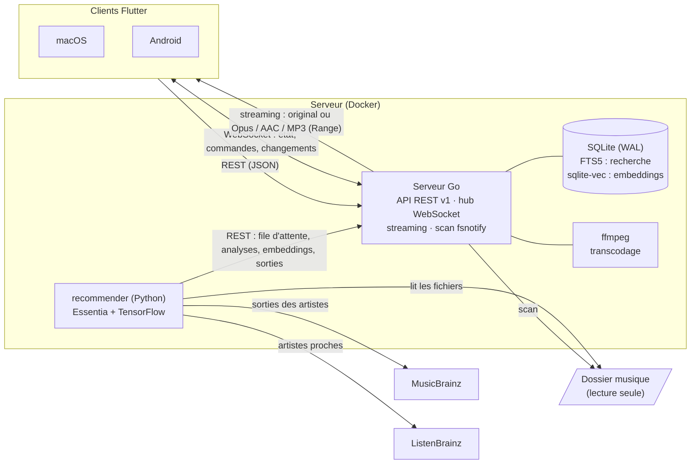

# Architecture

tty.fm se compose de trois parties, chacune dans son dossier du dépôt :

- **Serveur** (`server/`, Go) : il possède la bibliothèque et tout l'état. Il scanne le dossier musique, sert l'API REST v1, le streaming et le hub WebSocket, et calcule les recommandations à partir des données qu'on lui envoie.
- **Client** (`app/`, Flutter) : l'application native pour macOS et Android. Elle affiche, lit et met en cache ; elle ne calcule rien.
- **Recommender** (`recommender/`, Python + Essentia) : un service d'arrière-plan qui analyse l'audio et interroge MusicBrainz et ListenBrainz. Il ne touche jamais à la base : il lit les fichiers et renvoie ses résultats par l'API REST, comme un client.

## Serveur

- **Scan** : incrémental, déclenché au démarrage, par fsnotify et toutes les heures. Les tags sont lus avec TagLib, les pochettes redimensionnées en 64, 300 et 800 px. Détails dans [installation.md](installation.md#comportement-du-scan).
- **Base** : un seul fichier SQLite en mode WAL. La recherche passe par FTS5 (préfixes, accents ignorés) ; les embeddings des titres sont indexés dans une table `sqlite-vec`. Les migrations s'appliquent au démarrage.
- **Streaming** : le fichier original avec les requêtes Range, ou un transcodage ffmpeg (Opus, AAC, MP3) mis en cache sur disque.
- **Hub en direct** : une WebSocket par appareil. Le serveur relaie l'état de lecture et les commandes entre appareils (télécommande, transfert de lecture) et prévient quand la bibliothèque, les playlists ou les favoris changent. Rien de cet état n'est persisté.
- **Recommandations** : calculées par le serveur à partir des embeddings et de l'historique d'écoute.
  - titres similaires : distance cosinus entre embeddings ;
  - radio infinie : voisins du vecteur moyen de la graine et des derniers titres, avec des règles de diversité ;
  - mix du jour : k-means sur les embeddings des titres écoutés ces 28 jours, recalculé chaque nuit ;
  - nouvelles sorties et artistes à découvrir : rapprochement entre la bibliothèque et ce que le recommender rapporte de MusicBrainz et ListenBrainz.

L'API complète est décrite dans [api.md](api.md).

## Client

Flutter, Riverpod pour l'état, media_kit (libmpv) pour la lecture sans blanc entre les titres, audio_service pour les contrôles système. Chaque écran affiche d'abord la dernière réponse connue, puis la met à jour ; l'app choisit l'adresse locale quand elle répond, sinon l'adresse distante. Détails dans [app/README.md](../app/README.md#architecture).

## Recommender

Trois fils dans un même processus :

1. **Analyse audio** : bpm, tonalité, loudness, énergie, genre, ambiance et l'embedding Discogs EffNet de chaque titre, chaque fichier dans un processus séparé.
2. **Nouvelles sorties** : les albums, EP et singles des artistes de la bibliothèque sur MusicBrainz.
3. **Découverte** : les artistes proches des artistes likés, d'après ListenBrainz.

Détails dans [recommender/README.md](../recommender/README.md).
